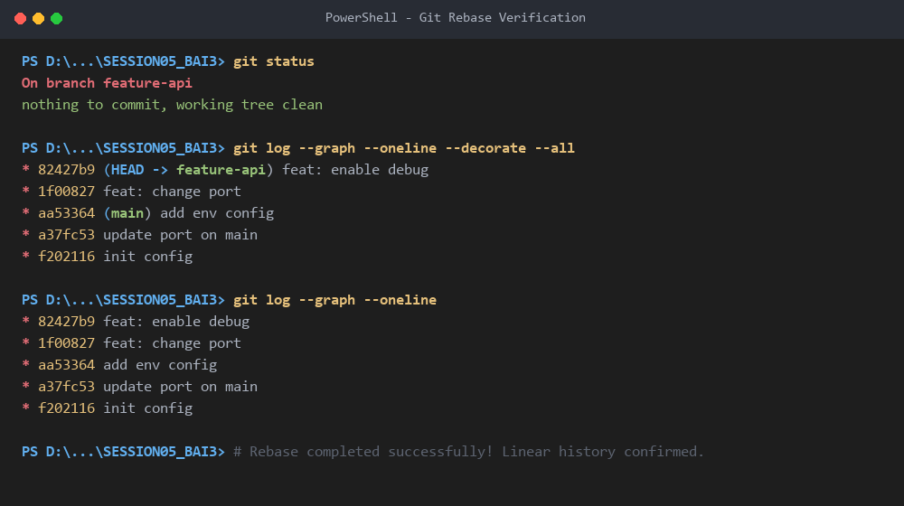

# BÁO CÁO BÀI TẬP 3: XỬ LÝ XUNG ĐỘT PHỨC TẠP TRONG QUÁ TRÌNH REBASE

---

## 1. THÔNG TIN BÀI TẬP
- **Môn học:** DevOps (IT209)
- **Bài thực hành:** Session 05 - Bài 3: Xử lý xung đột phức tạp trong quá trình Rebase
- **Đường dẫn nộp bài:** `homework/session_05/ex3/`
- **Mục tiêu:**
  - Hiểu rõ sự khác biệt giữa xử lý xung đột khi `merge` và khi `rebase`.
  - Nắm vững và áp dụng quy trình giải quyết xung đột từng bước (*step-by-step conflict resolution*) trong quá trình `rebase`.
  - Đưa toàn bộ lịch sử nhánh tính năng (`feature-api`) lên trên đỉnh nhánh chính (`main`) một cách thẳng tắp, sạch đẹp, không tạo merge commit phụ.

---

## 2. SO SÁNH GIẢI QUYẾT XUNG ĐỘT: MERGE VS REBASE

| Tiêu chí | Git Merge | Git Rebase |
| :--- | :--- | :--- |
| **Cơ chế hoạt động** | Tạo một commit gộp (3-way merge commit) kết nối hai nhánh lại với nhau. | Tạm thời cất các commit của nhánh hiện tại ra, đưa nhánh về đỉnh nhánh đích, sau đó lần lượt áp dụng (replay/cherry-pick) từng commit lên đỉnh mới. |
| **Tần suất xung đột** | Xung đột phát sinh **1 lần duy nhất** tại thời điểm tạo merge commit. | Xung đột có thể phát sinh **nhiều lần**, xuất hiện ở **từng commit** được replay nếu commit đó sửa cùng vị trí mà nhánh đích đã sửa. |
| **Lịch sử Git (Graph)** | Phân nhánh và hợp nhất lại (lịch sử dạng đồ thị mạng nhện), bảo toàn mốc thời gian commit gốc. | Lịch sử hoàn toàn **thẳng tắp** (linear history), các commit hash cũ được thay thế bằng hash mới. |
| **Trường hợp áp dụng** | Thích hợp khi hoàn tất feature branch merge vào main/develop hoặc cần giữ nguyên vẹn lịch sử gốc. | Thích hợp khi muốn cập nhật code mới nhất từ main vào feature branch trước khi tạo Pull Request, giữ Git log sạch sẽ. |

---

## 3. CÁC BƯỚC THIẾT LẬP MÔI TRƯỜNG & MÔ PHỎNG XUNG ĐỘT

### Bước 1: Khởi tạo repository và commit gốc trên `main`
Khởi tạo Git repo và tạo file cấu hình ban đầu `config.json`:
```bash
git init -b main
```

Nội dung ban đầu của `config.json`:
```json
{
  "port": 8080,
  "debug": false
}
```

Thực hiện commit khởi tạo:
```bash
git add config.json
git commit -m "init config"
```
*Kết quả:* Tạo root commit `f202116 init config`.

---

### Bước 2: Tạo nhánh `feature-api` và tạo 2 commit mới
Chuyển sang nhánh tính năng:
```bash
git checkout -b feature-api
```

#### Commit 1 trên `feature-api`: Đổi port thành `9000`
Sửa `config.json` thành:
```json
{
  "port": 9000,
  "debug": false
}
```
Commit:
```bash
git add config.json
git commit -m "feat: change port"
```
*Kết quả:* Tạo commit `f4b17a5 feat: change port`.

#### Commit 2 trên `feature-api`: Bật `debug` thành `true`
Sửa `config.json` thành:
```json
{
  "port": 9000,
  "debug": true
}
```
Commit:
```bash
git add config.json
git commit -m "feat: enable debug"
```
*Kết quả:* Tạo commit `49e8eee feat: enable debug`.

---

### Bước 3: Quay lại nhánh `main` và tạo 2 commit mới mô phỏng đồng nghiệp cập nhật
Chuyển về nhánh `main`:
```bash
git checkout main
```

#### Commit 1 trên `main`: Đổi port thành `8081`
Sửa `config.json` thành:
```json
{
  "port": 8081,
  "debug": false
}
```
Commit:
```bash
git add config.json
git commit -m "update port on main"
```
*Kết quả:* Tạo commit `a37fc53 update port on main`.

#### Commit 2 trên `main`: Thêm cấu hình môi trường `"env": "production"`
Sửa `config.json` thành:
```json
{
  "port": 8081,
  "debug": false,
  "env": "production"
}
```
Commit:
```bash
git add config.json
git commit -m "add env config"
```
*Kết quả:* Tạo commit `aa53364 add env config`.

---

### Tình trạng đồ thị Git TRƯỚC KHI REBASE
Kiểm tra bằng lệnh:
```bash
git log --graph --oneline --all
```

**Output:**
```text
* aa53364 (HEAD -> main) add env config
* a37fc53 update port on main
| * 49e8eee (feature-api) feat: enable debug
| * f4b17a5 feat: change port
|/  
* f202116 init config
```

> **Nhận xét:** Nhánh `main` và `feature-api` đã phân nhánh từ commit `f202116`. Cả hai nhánh đều sửa đổi cùng tệp tin `config.json` trên cùng các dòng cấu hình.

---

## 4. TIẾN TRÌNH REBASE & GIẢI QUYẾT XUNG ĐỘT TỪNG BƯỚC

Chuyển về nhánh `feature-api` và thực hiện lệnh rebase lên `main`:
```bash
git checkout feature-api
git rebase main
```

---

### 🛑 CHẶNG 1: Phát sinh xung đột tại commit 1 (`feat: change port`)

#### 1. Thông báo lỗi từ Git:
```text
Auto-merging config.json
CONFLICT (content): Merge conflict in config.json
Rebasing (1/2)error: could not apply f4b17a5... feat: change port
hint: Resolve all conflicts manually, mark them as resolved with
hint: "git add/rm <conflicted_files>", then run "git rebase --continue".
hint: You can instead skip this commit: run "git rebase --skip".
hint: To abort and get back to the state before "git rebase", run "git rebase --abort".
hint: Disable this message with "git config set advice.mergeConflict false"
Could not apply f4b17a5... # feat: change port
```

#### 2. Kiểm tra trạng thái:
```bash
git status
```
```text
interactive rebase in progress; onto aa53364
Last command done (1 command done):
   pick f4b17a5 # feat: change port
Next command to do (1 remaining command):
   pick 49e8eee # feat: enable debug
You are currently rebasing branch 'feature-api' on 'aa53364'.
  (fix conflicts and then run "git rebase --continue")
  (use "git rebase --skip" to skip this patch)
  (use "git rebase --abort" to check out the original branch)

Unmerged paths:
  (use "git restore --staged <file>..." to unstage)
  (use "git add <file>..." to mark resolution)
	both modified:   config.json

no changes added to commit (use "git add" and/or "git commit -a")
```

#### 3. Dấu vết xung đột trong `config.json`:
```json
{
<<<<<<< HEAD
  "port": 8081,
  "debug": false,
  "env": "production"
=======
  "port": 9000,
  "debug": false
>>>>>>> f4b17a5 (feat: change port)
}
```

#### 4. Phân tích & Giải quyết:
- **HEAD (trên main):** Đang có `"port": 8081` và `"env": "production"`.
- **Commit đang replay (`feat: change port`):** Muốn đổi `port` thành `9000`.
- **Nguyên tắc giải quyết:** 
  - Áp dụng thay đổi của tính năng: chọn `"port": 9000`.
  - **Không phá hỏng code của nhánh chính:** Giữ lại `"env": "production"` từ `main`.

#### 5. Nội dung `config.json` sau khi giải quyết thủ công:
```json
{
  "port": 9000,
  "debug": false,
  "env": "production"
}
```

#### 6. Đánh dấu đã giải quyết và tiếp tục rebase:
```bash
git add config.json
git rebase --continue
```
*Kết quả:* Commit `f4b17a5` được áp dụng thành công thành commit mới `1f00827`.

---

### 🛑 CHẶNG 2: Phát sinh xung đột tại commit 2 (`feat: enable debug`)

Ngay sau khi commit 1 hoàn tất, Git tiếp tục replay commit thứ hai và lập tức gặp xung đột tiếp theo:

#### 1. Thông báo lỗi từ Git:
```text
[detached HEAD 1f00827] feat: change port
 1 file changed, 1 insertion(+), 1 deletion(-)
Auto-merging config.json
CONFLICT (content): Merge conflict in config.json
Rebasing (2/2)error: could not apply 49e8eee... feat: enable debug
hint: Resolve all conflicts manually, mark them as resolved with
hint: "git add/rm <conflicted_files>", then run "git rebase --continue".
hint: You can instead skip this commit: run "git rebase --skip".
hint: To abort and get back to the state before "git rebase", run "git rebase --abort".
hint: Disable this message with "git config set advice.mergeConflict false"
Could not apply 49e8eee... # feat: enable debug
```

#### 2. Kiểm tra trạng thái:
```bash
git status
```
```text
interactive rebase in progress; onto aa53364
Last commands done (2 commands done):
   pick f4b17a5 # feat: change port
   pick 49e8eee # feat: enable debug
No commands remaining.
You are currently rebasing branch 'feature-api' on 'aa53364'.
  (fix conflicts and then run "git rebase --continue")
  (use "git rebase --skip" to skip this patch)
  (use "git rebase --abort" to check out the original branch)

Unmerged paths:
  (use "git restore --staged <file>..." to unstage)
  (use "git add <file>..." to mark resolution)
	both modified:   config.json

no changes added to commit (use "git add" and/or "git commit -a")
```

#### 3. Dấu vết xung đột trong `config.json`:
```json
{
  "port": 9000,
<<<<<<< HEAD
  "debug": false,
  "env": "production"
=======
  "debug": true
>>>>>>> 49e8eee (feat: enable debug)
}
```

#### 4. Phân tích & Giải quyết:
- **HEAD:** Đã có `"port": 9000`, `"debug": false` và `"env": "production"`.
- **Commit đang replay (`feat: enable debug`):** Sửa `"debug": true` nhưng ban đầu không có cấu hình `"env": "production"` ở sau, dẫn tới xung đột cú pháp JSON.
- **Nguyên tắc giải quyết:**
  - Áp dụng tính năng: Đổi `"debug": true`.
  - Giữ toàn vẹn cấu hình nhánh chính: Duy trì `"env": "production"`.
  - Đảm bảo cú pháp JSON hợp lệ (thêm dấu phẩy `,` sau dòng `debug`).

#### 5. Nội dung `config.json` sau khi giải quyết thủ công:
```json
{
  "port": 9000,
  "debug": true,
  "env": "production"
}
```

#### 6. Đánh dấu đã giải quyết và hoàn tất rebase:
```bash
git add config.json
git rebase --continue
```

**Kết quả màn hình hiển thị:**
```text
[detached HEAD 82427b9] feat: enable debug
 1 file changed, 1 insertion(+), 1 deletion(-)
Successfully rebased and updated refs/heads/feature-api.
```
> Rebase thành công 100%!

---

## 5. KIỂM TRA VÀ XÁC NHẬN KẾT QUẢ CUỐI CÙNG

### 1. Kiểm tra trạng thái Git (`git status`)
```bash
git status
```
**Output:**
```text
On branch feature-api
nothing to commit, working tree clean
```
*(Trạng thái sạch sẽ, không còn xung đột tồn đọng).*

---

### 2. Kiểm tra lịch sử Git sau khi hoàn thành (`git log --graph --oneline`)
```bash
git log --graph --oneline
```
**Output:**
```text
* 82427b9 feat: enable debug
* 1f00827 feat: change port
* aa53364 add env config
* a37fc53 update port on main
* f202116 init config
```

Xem đầy đủ với tất cả các nhánh (`git log --graph --oneline --decorate --all`):
```text
* 82427b9 (HEAD -> feature-api) feat: enable debug
* 1f00827 feat: change port
* aa53364 (main) add env config
* a37fc53 update port on main
* f202116 init config
```

> 📷 **Ảnh chụp màn hình kết quả Git Log và Git Status sau Rebase:**
>
> 

#### Đồ thị trực quan so sánh Trước & Sau Rebase:

```text
TRƯỚC KHI REBASE:                          SAU KHI REBASE:
                                           * 82427b9 (HEAD -> feature-api) feat: enable debug
* aa53364 (main) add env config            * 1f00827 feat: change port
* a37fc53 update port on main              * aa53364 (main) add env config
| * 49e8eee (feature-api) feat: enable     * a37fc53 update port on main
| * f4b17a5 feat: change port              * f202116 init config
|/                                         (Lịch sử hoàn toàn thẳng tắp!)
* f202116 init config
```

---

### 3. Nội dung tệp tin `config.json` cuối cùng
```json
{
  "port": 9000,
  "debug": true,
  "env": "production"
}
```
- ✅ `"port": 9000`: Từ commit `feat: change port` của feature branch.
- ✅ `"debug": true`: Từ commit `feat: enable debug` của feature branch.
- ✅ `"env": "production"`: Từ commit `add env config` của main branch.
- ✅ JSON hợp lệ, không mất code của nhánh chính, không tạo merge commit phụ.

---

## 6. KẾT LUẬN VÀ BÀI HỌC KINH NGHIỆM
1. **Bản chất của Rebase:** Khác với Merge chỉ giải quyết xung đột 1 lần duy nhất, Rebase áp dụng lại từng commit một (*cherry-pick sequential*). Do đó, nếu nhiều commit trên nhánh feature sửa cùng vùng mã nguồn mà nhánh main cũng sửa, xung đột sẽ xuất hiện ở **từng commit một**.
2. **Quy trình chuẩn khi Rebase gặp xung đột:**
   - Bước 1: Khi Git báo conflict, dùng `git status` để xem tệp tin bị xung đột.
   - Bước 2: Mở tệp tin, xem xét các marker `<<<<<<< HEAD`, `=======`, `>>>>>>>` và sửa mã nguồn bằng tay.
   - Bước 3: Đưa tệp tin vào staging area bằng `git add <tệp_tin>`.
   - Bước 4: Tiếp tục tiến trình bằng `git rebase --continue`. Tuyệt đối **không** dùng `git commit`.
   - Bước 5: Lặp lại cho đến khi nhận được thông báo `Successfully rebased`.
   - *(Lưu ý: Nếu muốn hủy bỏ an toàn về trạng thái ban đầu, sử dụng `git rebase --abort`).*
3. **Giá trị thực tiễn:** Rebase giúp lịch sử dự án tuyến tính, sạch đẹp, dễ theo dõi tiến trình phát triển và dễ dàng thực hiện `git bisect` khi cần tìm lỗi trong hệ thống CI/CD DevOps.
